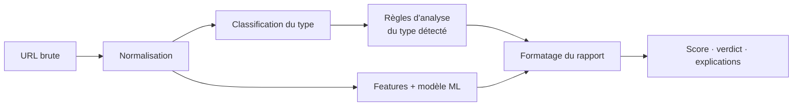

# 🛡️ UrlShield

**Détecteur de phishing par analyse d'URL : des règles explicables + un modèle de machine learning, le tout exposé via une API et une interface web.**


UrlShield prend une URL, la classe selon sa **structure**, applique les **règles d'analyse** propres à ce type, calcule un **score ML** (probabilité de phishing en %), puis renvoie un **rapport structuré** : score, verdict et explications lisibles.

**Sommaire** : [Fonctionnement](#fonctionnement) · [Types d'URL](#types-durl-analysés) · [Installation](#installation) · [API](#api) · [Modèle ML](#modèle-ml) · [Tests](#tests) · [Limites](#limites-connues) · [Structure](#structure-du-projet)

---

## Fonctionnement

Chaque URL passe par le même pipeline :



*(schéma simplifié)*

| Étape | Rôle | Code |
|---|---|---|
| Normalisation | Nettoie et prépare l'URL | `App/Core/normalizer.py` |
| Classification | Détermine le type structurel de l'URL | `App/Core/classifier.py` |
| Analyse par règles | Détecte les signaux de fraude (domaine, sous-domaines, paramètres douteux, redirections, mots-clés suspects, longueur...) | `App/Analysis/` |
| Score ML | Estime la probabilité de phishing à partir de features extraites de l'URL | `ML/phishing_model.py` |
| Rapport | Assemble score, verdict et messages explicatifs | `App/Explaining/` |

L'intérêt de combiner les deux approches : les règles disent **pourquoi** une URL est suspecte, le modèle ML capte des combinaisons de signaux que les règles seules ne voient pas.

## Types d'URL analysés

Les règles dépendent de la forme de l'URL. Chaque type a son propre analyseur et ses propres tests :

| Type | Analyseur | Tests |
|---|---|---|
| Hiérarchique | `App/Analysis/hierarchical/` | `Tests/hierarchical_test.py` |
| Embedded | `App/Analysis/embedded/` | `Tests/embedded_test.py` |
| Nested | `App/Analysis/nested/` | `Tests/nested_test.py` |
| Opaque | `App/Analysis/opac/` | `Tests/opac_test.py` |

Les règles communes à tous les types sont dans `App/Analysis/rules.py`.

## Installation

**Prérequis** : Python 3.10+, pip, et une connexion internet au premier lancement (téléchargement des datasets d'entraînement).

```bash
git clone https://github.com/Dhia-sel/Projet-Detecteur-Url.git
cd Projet-Detecteur-Url

python -m venv .venv
source .venv/bin/activate          # Linux / macOS
# .\.venv\Scripts\Activate.ps1     # Windows PowerShell

pip install -r requirements.txt
```

### Démarrage rapide

```bash
# 1. (recommandé) préparer les datasets et le modèle avant le premier scan
python ML/download_training_datasets.py

# 2. lancer l'API
uvicorn API.server:app --host 0.0.0.0 --port 8000 --reload

# 3. lancer l'interface web (dans un autre terminal)
python -m http.server 8080 --directory Frontend
```

- API : http://localhost:8000
- Documentation Swagger : http://localhost:8000/docs
- Interface web : http://localhost:8080

> Si `ML/phishing_model.joblib` est absent, le modèle est entraîné automatiquement au premier scan, ce qui rend cette première requête plus longue.

## API

| Méthode | Route | Description |
|---|---|---|
| `POST` | `/api/scan` | Analyse complète d'une URL : type, règles, score ML, verdict |
| `POST` | `/api/ml/score` | Score du modèle ML seul pour une URL |

### Exemple

```bash
curl -X POST "http://localhost:8000/api/scan" \
  -H "Content-Type: application/json" \
  -d '{"url":"https://example.com/login"}'
```

Réponse (abrégée) :

```json
{
  "url": "https://example.com/login",
  "ml": {
    "status": "ready",
    "score": 64.2,
    "verdict": "suspicious"
  },
  "url_type": "hierarchical",
  "report": {
    "data": []
  }
}
```

La réponse contient l'URL analysée, son type, le rapport des règles, le score ML (en %), le verdict et les informations de diagnostic.

## Modèle ML

- **Algorithme** : `HistGradientBoostingClassifier` (scikit-learn).
- **Entrée** : des features calculées à partir de la chaîne de l'URL (longueur, caractères spéciaux, sous-domaines, entropie, mots-clés suspects...).
- **Sortie** : un pourcentage de probabilité de phishing.
- **Données** : [PhiUSIIL Phishing URL Dataset](https://archive.ics.uci.edu/dataset/967/phiusiil+phishing+url+dataset) (UCI) et les jeux récupérés par `ML/download_training_datasets.py`.
- **Fichiers** : modèle sauvegardé dans `ML/phishing_model.joblib`, données dans `ML/datasets/` et `ML/phiusiil.csv`.

> ⚠️ Le fichier `.joblib` doit être chargé avec la même version de scikit-learn que celle utilisée pour l'entraînement. Fixe la version dans `requirements.txt`.

## Tests

```bash
pytest
```

Les tests couvrent chaque famille d'analyseurs (`Tests/hierarchical_test.py`, `embedded_test.py`, `nested_test.py`, `opac_test.py`).

## Limites connues

UrlShield est une **aide à la décision**, pas une garantie :

- Le modèle ne regarde que **la chaîne de l'URL**. Un site légitime compromis ou un lien raccourci peut passer inaperçu.
- Les jeux de données publics ont leurs biais : les performances mesurées sur un dataset sont généralement plus élevées que sur le web réel.
- Le score ML est une probabilité estimée, non calibrée sur du trafic réel. Utilise-le comme un score de risque et croise-le avec le rapport des règles.
- Un attaquant qui connaît les features peut chercher à les contourner ; le modèle doit être réentraîné régulièrement.

## Structure du projet

```text
Projet-Detecteur-Url/
├── API/
│   ├── routes/scan.py              # routes /api/scan et /api/ml/score
│   ├── schema/scan_schema.py       # schémas de requête / réponse
│   └── server.py                   # application FastAPI
├── App/
│   ├── Analysis/                   # règles par type d'URL
│   │   ├── embedded/
│   │   ├── hierarchical/
│   │   ├── nested/
│   │   ├── opac/
│   │   └── rules.py                # règles communes
│   ├── Core/                       # normalizer, classifier, pipeline, constants
│   ├── Explaining/                 # formatter et messages du rapport
│   ├── MachineLearning/
│   ├── Parsers/
│   ├── Utils/
│   └── main.py
├── Docs/architecture.md            # documentation d'architecture
├── Frontend/                       # interface web (html, css, js)
├── ML/                             # modèle, datasets, entraînement
├── Tests/                          # tests par type d'URL
├── requirements.txt
└── README.md
```

Pour plus de détails sur la conception, voir [`Docs/architecture.md`](Docs/architecture.md).

## Pistes d'amélioration

- Allowlist des domaines très populaires pour limiter les faux positifs.
- Croisement avec des listes de phishing connues (PhishTank, OpenPhish).
- Évaluation du modèle par domaine et sur des URLs récentes, avec les métriques publiées ici.
- Conteneurisation (Docker) pour simplifier le déploiement.